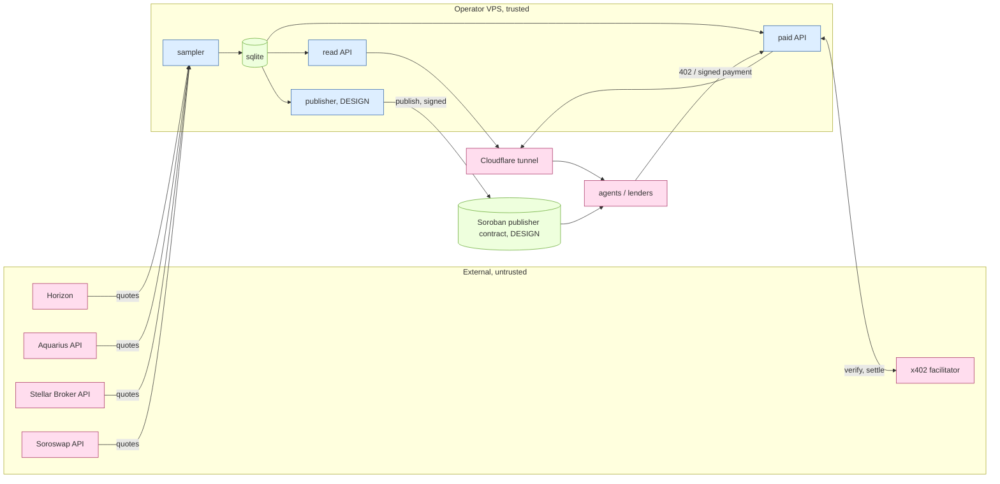

# sounding: technical architecture (SCF #46, Integration Track)

Exit liquidity for Stellar assets, as a service. One question per call:

> How much of asset X can I sell on Stellar right now, and what does it cost, at size S?

It quotes four exit venues (SDEX through Horizon paths, the Soroswap aggregator, Aquarius, Stellar
Broker), takes the largest size that stays inside 50, 100, 200 and 500 bps, and refuses to publish
a number when the evidence is stale, one-sided, or contradictory. Agents pay per call in USDC over
x402. Later a Soroban contract publishes the safe size as an onchain risk parameter for any lending
venue.

Nothing here requires Blend. Blend is one possible consumer (section 1) and one measured data point
of history (section 13).

**Status legend.** `BUILT` = in this repository, run, and tested. `LIVE` = running now at
<https://sounding.ochinimus.app>. `DESIGN` = specified here, not built. `ESTIMATE` = a number I have
not measured. Where a thing is only documented by a third party and I did not execute it, it says
`UNTESTED`.

---

## 1. The problem without Blend

Every Stellar lending venue has to answer one question before it accepts an asset as collateral:
if this position has to be sold, at what size does the exit stop being cheap? An oracle answers
"what is one unit worth". It does not answer "how many units will the market absorb before that
price is gone". Exit liquidity is a separate quantity, it is measurable, and nobody publishes it
for Stellar.

The consumers are any venue with liquidations or sized limits: Blend if it recovers, Templar,
Kinetic K2, vault managers, and agents that need to size a sell before they make it. None of them is
integrated today and this document does not claim they are; the claim is that the same published
number serves all of them and none of them has to depend on any one of them.

Why this is a product on Stellar specifically:

- SDEX is a native order book. For the direct book, depth is read in one call and the crossing
  point of a tolerance is closed form (`src/depth.mjs`), where on an AMM chain it can only be
  inferred by probing.
- Stellar splits liquidity across surfaces that behave differently: the classic book and classic
  pools (reached by Horizon `strict-send` paths), Soroban AMMs (Aquarius, Soroswap, Sushi V3,
  Comet), and routers over both (Soroswap aggregator, Stellar Broker). A single-venue number
  misleads in both directions, and the data shows it: on 2026-10-25 selling $100k of EURC cost
  49 bps through Stellar Broker and 6,101 bps through the Aquarius path finder, for the same asset
  in the same cycle.

## 2. The four venues and how each is integrated

Detailed requests, responses, auth, rate limits and failure modes: [`docs/VENUES.md`](docs/VENUES.md).

| venue | Integration List block? | integration | state | hours |
|---|---|---|---|---|
| Aquarius | **yes** (List estimate: under 1 day) | `POST /api/external/v2/find-path/`, no key. Adapter `src/venues/aquarius.mjs`. | BUILT, LIVE, sampled every 10 min | List estimate <1 day. Read adapter, fixtures and tests are done. Remaining ESTIMATE ~8 h: read pool reserves straight from the pool contracts over Soroban RPC to cross-check the API without trusting it. |
| Soroswap | **yes** (List estimate: 1-2 weeks) | `POST api.soroswap.finance/quote`, Bearer key (free plan, 1 req/s). Whole aggregate plus one call per protocol (`soroswap`, `aqua`, `sushi`, `comet`, `sdex`). Adapter `src/venues/soroswap.mjs`. | adapter BUILT and unit-tested against the documented shape; **no live quote yet, key pending (UNTESTED live)** | ESTIMATE 40-60 h total: key and live capture (1 h), per-pool reads for the independent-depth set (Soroswap, Sushi V3, Comet pools) (20 h), onchain aggregator cross-check (20 h), hardening (10 h). |
| Stellar Broker | **yes** (List estimate: 1-5 days) | `GET api.stellar.broker/quote` (what `@stellar-broker/client` `estimateSwap` calls), no key for estimates. Adapter `src/venues/broker.mjs`. | BUILT, LIVE, sampled every 10 min | List estimate 1-5 days. Read adapter done. Remaining ESTIMATE ~12 h: partner key for a stated rate limit, stream quotes over the client WebSocket for faster disagreement detection, track the audited router's contract id. |
| SDEX via Horizon | no (public API) | `GET /paths/strict-send`, no key; `GET /order_book` for the closed-form book. Adapter `src/venues/horizon.mjs`, math `src/depth.mjs`. | BUILT, LIVE | done |

Building blocks used from the Integration List: **Aquarius, Soroswap, Stellar Broker**.

What is integrated versus planned, in one line each: Aquarius and Stellar Broker are sampled live
today; Soroswap is wired and waiting for a key; reading pools directly from contracts is planned for
all three and is the part of the budget that makes the numbers independent of any API operator.

Every adapter returns a three-way verdict, `ok`, `no_route` or `failed(kind)`. A failure is stored
as a typed row and is never read as zero liquidity. This rule is enforced in the adapters, the
sampler, the mark and the safe-size functions, and each has a test that fails if it is broken
(`test/venues.test.mjs`, `test/engine.test.mjs`, `test/sampler.test.mjs`, `test/read.test.mjs`).

## 3. Engine math

All pure functions, no I/O, no clock: `src/engine.mjs` (plus `src/depth.mjs` for the order book).
`npm test` runs the offline suite (82 tests at the time of writing, no network).

**Asset universe.** Candidates are the classic-issued assets in the live Aquarius pool list (and the
Soroswap pool list once a key exists), each *measured* (`bin/discover.mjs`) against USDC through
Horizon and Aquarius at $10k and $100k. The Aquarius list carries no reserves or TVL, so assets
are ranked by measured exit cost, not by list order. The universe on 2026-10-25 is ten assets:
XLM, EURC, AQUA, yXLM, USTRY, PYUSD, ETH, BTC, XRP, SHX (`data/universe.json`). XLM, EURC and AQUA
are mandatory; the rest were curated from the measured list to include wrappers and a deliberately
thin asset (SHX). Soroban-only tokens with no classic identity (e.g. SolvBTC) are out of scope for
now because Horizon and Stellar Broker cannot quote them.

**Sizes.** $1k, $10k, $100k, $1M, each converted to units with the cycle's mark.

**Reference mark.** The median of proceeds-per-unit over the venues that answered at $1k
(`markFromSmallQuotes`). Why not Reflector: it needs an extra dependency and an onchain read, and
at $1k every venue's price impact is a few bps, so the median is a fair "price right now" that is
contemporaneous with the exit quotes it is compared to. What it hides: if every venue is wrong
together at $1k the mark is wrong too, and the venue fee is inside it. Reflector as an independent
cross-check is planned, not built. A failed venue is excluded from the median; it is never a zero.

**Cost.** `cost_bps = (1 - proceeds / (mark * units)) * 10000`. Positive is worse than the mark; a
venue paying above the mark reports a negative cost and it is kept, not clipped.

**Outputs per (asset, size).** Per-venue proceeds and cost, the best exit (max proceeds over the
four venues), the disagreement between the two best, and per-venue rows for Soroswap's protocols.

**Safe size at 50, 100, 200, 500 bps.** Three methods, each labelled in the output:

1. `closed_form_orderbook`: for the direct SDEX book. Walk the cumulative bid curve once and solve
   `(proceeds + x*p) / (size + x) = floor` for the partial level (`safeCollateralSize`). Exact, one
   call, no probing. It sees only the direct book.
2. `interpolated_quotes`: for the routed best-exit curve. The four measured sizes give four
   (size, cost) points; the answer is the largest size inside tolerance by interpolation linear in
   cost and logarithmic in size. It never extrapolates: if even $1M is inside the tolerance the
   answer is a lower bound and says `sample_cap`; if even $1k is outside it is 0
   (`below_min_sample`). **It is conservative:** exit cost is convex in log size, so the straight
   line between two samples lies above the curve and the interpolated size is too small. Measured on
   2026-10-25 for XLM at 200 bps: interpolated $119k, closed-form book $264k, bisected $305k
   (`docs/RESULTS.md`). The published size inherits this, which is the safe direction for a limit.
   Planned: feed the hourly bisection probes back in as extra curve points.
3. `bisection_quotes`: for AMMs, where there is no closed form. Once an hour, per asset and
   tolerance, bisect live quotes (geometric midpoints, 7 iterations, on the venue that was
   cheapest at $100k). A failed quote aborts the search as `limited_by: failed`; it is never read
   as "too expensive" or as size 0.

**Venue share of the best exit.** For each tolerance, each independent venue's safe size as a share
of the share-capped total (`venue_depths[tol].shares`).

**Disagreement flag.** Gap between the best and second-best proceeds, in bps of the best; flagged
above 300 bps (configurable). The refusal test uses the gap at $1k (section 4), not at large sizes,
where venues legitimately diverge.

## 4. Manipulation resistance

Depth is cheap to fake for one block and expensive to fake for an hour. Four mechanisms, all in
`src/engine.mjs` and applied in `src/read.mjs`:

1. **Time-weighted depth** (`effectiveDepth`). The published size is the time-weighted mean of the
   per-cycle safe size over the last 6 cycles (about an hour). A book stuffed shortly before a read
   cannot move the number.
2. **Appearing-level discount.** The published size is `min(time-weighted mean, latest)`. A level
   that has only just appeared is averaged down by the window; a level that has just vanished takes
   effect at once. It is conservative in both directions. Tests: a spike in the last cycle does not
   raise the published size; a drop applies immediately (`test/read.test.mjs`).
3. **Venue share cap** (`cappedDepth`, default 0.6). Only independent pools are summed
   (`sdex_horizon`, `aquarius`, and the Soroswap, Sushi and Comet pools once keyed). Stellar Broker
   and the aggregator re-route over those same pools, so counting them would double count. No venue
   may carry more than 60% of the published total, which limits any one venue to 1.5x the sum of the
   others. A single venue alone is never trusted: published size 0, reason `single_venue_depth`.
   The cost is real and stated: on 2026-10-25 XLM's 50 bps size is $29.6k published against $101k
   on the best single-exit curve, because Aquarius' XLM pool is thin. The raw best-exit figure is
   returned next to the published one.
4. **Disagreement refusal.** If the best venue pays more than 300 bps above the second-best at $1k,
   the report is refused (`venues_disagree`). The test is asymmetric on purpose: a single venue that
   pays far *more* than the rest is the signature of a spoofed or manipulated bid; one venue that
   pays far *less* is merely a venue a seller would not use, and is not grounds to refuse. Fewer
   than two venues answering at $1k is also a refusal (`fewer_than_two_venues_at_1k`).

A refused or stale report keeps `published.publishable: false`, lists `reasons`, and still returns
the raw per-venue data, so a consumer can see why.

## 5. Staleness bounds and the consumer rule

Every report carries `ts`, `age_s`, `stale`, `stale_bound_s` and `stale_bound_basis`. It is stale when
`age_s` exceeds the bound.

**Per-asset bound from measured drift** (`staleBoundFromDrift`, series from `driftSeries` in
`src/read.mjs`). The drifting quantity is the best-exit price at $100k per cycle, `mark x (1 - best
cost)`, so it moves when the price moves *and* when depth appears or vanishes; a mark-only series
would call an asset calm while its book is being pulled (test: `depth drift shortens the stale bound
even when the mark never moves`). Over the last 24 h: `sigma` = standard deviation of the log-return
between consecutive cycles;
`cycles_allowed = (100 bps / sigma)^2` (a random walk's deviation grows with the square root of
elapsed cycles); `bound = clamp(cycles_allowed * median cycle gap, 1200 s, 7200 s)`. The floor is
two cycles; the ceiling is two hours. With fewer than six marks the default is 3,600 s and the
basis says `too_few_samples`. The bounds measured so far are in section 12 and are recomputed on
every request, so they follow the asset's volatility.

**Consumer rule: hold, never raise.** On a stale or refused reading a consumer keeps its current
limit. It does not raise it, it does not act on the old number, and it does not fall back to an
oracle mark alone (which is the failure this system exists to prevent). Encoded and tested as
`nextLimit`. A fresh reading may move the limit up or down.

## 6. x402 on Stellar: payment flow

BUILT and proven on **testnet only**. Mainnet is tranche 1 of the grant and needs the owner's
receiving account and an OpenZeppelin mainnet key; it is not configured and **UNTESTED**.

```
agent                         sounding.ochinimus.app             x402.org/facilitator (stellar:testnet)
  |  GET /paid/v1/exit?asset=XLM&size=100000                            |
  |------------------------------>|                                     |
  |  402 + PAYMENT-REQUIRED       |  exact, stellar:testnet,            |
  |<------------------------------|  amount 100000 (= $0.01 testnet USDC, 7 dp),
  |                               |  asset = testnet USDC SAC, payTo G...
  |  sign a Soroban auth entry for the USDC SAC transfer (client only signs)
  |  GET same URL + PAYMENT-SIGNATURE                                   |
  |------------------------------>|  verify ----------------------------->|
  |                               |  <------------------------------ valid |
  |                               |  settle ----------------------------->|  submits the tx, fees sponsored
  |  200 + PAYMENT-RESPONSE       |  <------------- {success, transaction} |
  |<------------------------------|
```

Stack: `@x402/express`, `@x402/core`, `@x402/stellar` 2.28.0, wired the way
`stellar/x402-stellar` `examples/simple-paywall` wires it (`x402ResourceServer` +
`ExactStellarScheme` + `HTTPFacilitatorClient`). The facilitator's own `/supported` lists
`exact` on `stellar:testnet` with `areFeesSponsored: true`. The server never holds the payer's key
and never submits the transaction; the payer signs only an authorization.

**Proof (one real call, 2026-10-25, via `scripts/x402-testnet-pay.mjs`):** unpaid request -> 402;
signed retry -> 200 with the report; settlement transaction
[`7a9c3cd9e2693cc8419459248a8fd24c96cd3a611b384f2c39409c984c2f2db4`](https://stellar.expert/explorer/testnet/tx/7a9c3cd9e2693cc8419459248a8fd24c96cd3a611b384f2c39409c984c2f2db4)
(ledger 5385598, `invoke_host_function`, successful on Horizon testnet). The receiving account went
from 0 to 0.0100000 testnet USDC. The testnet payer bought its USDC on the testnet DEX with
friendbot XLM (the Circle faucet needs a human captcha).

**Onchain success metric that is not our own activity:** the number of distinct Stellar accounts,
other than sounding's own, that settle USDC payments to the receiving address, read from the public
ledger (Horizon `payments`/`transactions` for the address, own wallets listed and excluded). It is
verifiable by anyone and cannot be moved by the team's own calls. Today it is 0 on mainnet by
construction (mainnet is not live); the one testnet payer is ours.

## 7. The Soroban publisher contract (DESIGN)

Not built. It publishes the safe size as an onchain risk parameter any lending contract can read.
Written here so its failure behaviour is reviewable before any code exists.

```
init(admin, publisher, bounds)                       one-time
publish(asset, tol_bps, safe_usd, observed_ts, seq)  publisher only
get(asset, tol_bps) -> { value, observed_ts, state } state in { Fresh, Stale, Paused }
pause() / unpause()                                  admin only
set_publisher(new)                                   admin only: rotates the signing key
propose_admin(new) / accept_admin()                  two-step admin handover
```

- **Bounded publishes.** `publish` rejects a value outside a per-asset floor/ceiling band, a step
  larger than a configured fraction of the previous value (so one bad publish cannot swing a risk
  parameter), an `observed_ts` that is older than the previous or in the future, and a `seq` that
  is not strictly increasing. Rejection is a contract error and an event; nothing is written.
- **Correction is a new timestamped publish.** There is no overwrite. A correction is a normal
  `publish` carrying `corrects: seq`, with a new `observed_ts`; the earlier value stays in the event
  log. History is readable onchain.
- **Explicit stale state.** `get` compares the ledger time with `observed_ts` against a per-asset
  `max_age` (the section 5 bound, set at `init` and changed only by admin) and returns
  `state: Stale` with the last value, never a bare number. Archived state (Soroban TTL expiry)
  also reads as `Stale`. The publisher extends TTL on every publish.
- **Admin pause.** While paused, `get` returns `state: Paused` and no usable value. Pausing is
  always safe because the consumer rule for `Stale` and `Paused` is the same: hold, never raise.
- **Key rotation.** `set_publisher` replaces the publishing key; `propose_admin` / `accept_admin`
  replaces the admin without a window in which nobody controls it. The admin is intended to be a
  multisig account; the publisher is a single hot key that can only call `publish`.
- **Events** for every state change (`Published`, `Rejected`, `Corrected`, `Paused`, `Unpaused`,
  `PublisherSet`, `AdminProposed`, `AdminAccepted`) so section 9's monitors read the chain, not
  the operator.

Plan: testnet deployment first (ESTIMATE 40 h including tests with the Soroban test harness), an
external review of the contract before any mainnet write, then mainnet with the lowest-risk assets.

## 8. Threat model (STRIDE)

Data flow (trust boundaries: external services and the public edge versus the operator's box):



| STRIDE | threat | where | mitigation (BUILT unless marked) | residual |
|---|---|---|---|---|
| **S**poofing | a venue API is impersonated or DNS-hijacked and returns attractive quotes | sampler <- venues | HTTPS; disagreement refusal at $1k catches a venue paying far more than the rest; independent-venue share cap | all four APIs compromised together |
| | a payer or the facilitator is impersonated | paid API | x402 verify/settle by the facilitator; the server never serves a paid response without a successful verify | trust in the facilitator operator (testnet: x402.org; mainnet: OpenZeppelin) |
| | a stranger calls `publish` | contract (DESIGN) | `publisher` auth; two-step admin | key compromise (section 10) |
| **T**ampering | quotes or the sqlite file altered | sampler, box | box access limited to the operator; read API opens the DB read-only; nightly backup; the public CSV history is an off-box copy | operator box compromise |
| | a venue returns manipulated depth | venues | time-weighted depth, appearing-level discount, share cap, disagreement refusal (section 4) | sustained multi-venue manipulation for an hour or more is expensive but not impossible; the published number is conservative, not a guarantee |
| | a bad value published onchain | contract (DESIGN) | bounded step and band, monotone `seq`/`observed_ts`, correction as a new publish | band set wrongly |
| **R**epudiation | "you told us it was safe" | operator | every sample stored with timestamp, venue, status and cost; history public and CC BY; onchain events (DESIGN) | none material |
| **I**nformation disclosure | secrets leaking: Soroswap key, publisher key, payTo secret | box, repo | `.env` mode 600 and gitignored; secrets only on the box; full-history secret scan before the repo was made public; only a key's length is ever logged | box compromise |
| | the data itself | API | it is public by design | none |
| **D**enial of service | venue API down or rate-limiting | sampler | typed failures, per-venue lanes with minimum gaps, 429 back-off; fewer than two venues -> refuse; no outage reads as zero | all venues down -> reports go stale (the intended failure) |
| | flood on the public API | API | per-IP limits (60/min exit, 6/min CSV); Cloudflare in front; the sampler is a separate process | volumetric attack on the tunnel host |
| | publisher outage | contract (DESIGN) | values age into `Stale`; failure is toward refusal | consumers must implement hold-on-stale |
| **E**levation of privilege | publisher key used to pause or rotate | contract (DESIGN) | publisher can only `publish`; admin is a different, multisig key | admin multisig compromise |
| | a dependency (npm) is malicious | build | sampler and API have **zero npm dependencies** (Node built-ins only); the paid server pins `@x402/*` 2.28.0 and the lockfile, `npm ci`, and overrides `axios` to `^1.20.0`. `npm audit` on 2026-10-25 still lists 5 advisories in that tree (zod memory exhaustion via `@x402/core`, no upstream fix); the sampler and API are unaffected | supply chain of Express and the x402 packages; re-audit before mainnet |
| | the x402 client signs more than intended | payer | the stock client's default $1 cap and default-assets-only filter are left on in `scripts/x402-testnet-pay.mjs` | none |

## 9. Monitoring plan

Threat -> signal -> severity -> response. Offchain signals exist today; onchain signals read the
publisher contract's events (DESIGN) so they do not depend on the operator's own logs.

| threat | signal | where | severity | response |
|---|---|---|---|---|
| sampler dead | `/healthz` `last_cycle_age_s` > 1500 (2.5 cycles); report `stale: true` | `/healthz`, `/v1/exit` | high | operator restarts via `ops/pm2-start.sh`; consumers already hold |
| a venue failing | `failures_by_kind` growing for one venue; failed share per cycle > 30% | `/v1/stats` | medium | check the venue; it drops out of the independent set; fewer than two venues refuses |
| rate limiting | `rate_limited` count > 0 | `/v1/stats` | low | raise the lane gap; upgrade the Soroswap plan if sustained |
| manipulated or spoofed depth | `price_agreement_at_1k.flag` true; best venue > 300 bps above second at $1k | `/v1/exit` | high | automatic refusal; operator inspects the venue's pool |
| depth collapse | published size falls by more than half between consecutive cycles | history CSV | medium | consumers lower limits (the min-with-latest rule already does) |
| single-venue dependence | `cap_limited_by: single_venue` | `/v1/exit` | medium | publishes 0 (automatic); investigate the second venue |
| API schema change | `parse_error` count > 0 | `/v1/stats` | high | adapter fix; the venue is `failed`, never zero |
| payments broken | paid call returns 5xx or no settlement; facilitator `/supported` unreachable | paid API logs | medium | switch facilitator (one URL), section 10 |
| key compromise (DESIGN) | `Published` event from an unexpected source, a `PublisherSet`/`AdminProposed` event nobody ordered, publish-rate spike | chain events | critical | `pause()` first, then rotate (section 10) |
| bad publish (DESIGN) | `Rejected` events; a `Published` value outside the independent re-computation by more than the band | chain events + `/v1/exit` | high | correct by a new publish; pause if repeated |
| contract state expiry (DESIGN) | `get` returns `Stale` with archived state; TTL margin below 30 days | chain | medium | restore and bump TTL |
| continuity | no commit or sample for 14 days; backup log stale | repo, `/opt/backups/sounding-backup.log` | medium | section 11 |

## 10. Failure and recovery runbook

Who: the maintainer (a single operator; there is no co-maintainer, section 11). Commands are in
[`docs/DEPLOY.md`](docs/DEPLOY.md).

**Outage (sampler, box, tunnel).** Nothing to do for safety: reports go stale and the consumer rule
(hold, never raise) applies. To recover: `ssh <box>`; `pm2 jlist`; `sh /opt/sounding/ops/pm2-start.sh`;
`curl /healthz`. If the box is lost: new box, `docs/DEPLOY.md` sections 1-5, restore the latest
`sounding-*.db` backup or start empty (the CSV history is public). A fresh reading appears after one
cycle (about 45 s with three venues, about 5 minutes once Soroswap is added).

**Bad data.** Offchain: a venue's parse failure or an implausible quote becomes a typed failure, not
a number. Onchain (DESIGN): an out-of-band publish is rejected by the contract; a wrong value that
passed is corrected by a new publish with a new timestamp (history stays), and the contract is
paused if two consecutive publishes were wrong.

**Key compromise (DESIGN).** 1) The admin multisig calls `pause()`. Consumers now read `Paused` and
hold. 2) `set_publisher(new_key)` on the contract; remove the old key from the box. 3) Read the event
log for every `Published` since the suspected time; publish corrections. 4) `unpause()` after a clean
cycle. 5) If the *admin* is suspected: `propose_admin` from the surviving signers and `accept_admin`
from the new multisig. The sampler, API and paid keys are separate: the Soroswap key is rotated at
`api.soroswap.finance`, and the payTo account has no signing key on the box.

**Who pauses, how it rotates.** The admin multisig pauses and rotates; the publisher key cannot. The
multisig signer set and thresholds will be published before mainnet. A pause is always safe.

**Dependency or facilitator loss.** Facilitator down: set `X402_FACILITATOR_URL` and restart
`sounding-paid` with delete + start. An API venue removed: its adapter returns `failed`; if fewer
than two independent venues remain the reports refuse.

## 11. Continuity without a named co-maintainer

There is one maintainer and this document does not invent another. The answer to key-person risk is
artifacts that let anyone else take over, and a design that fails safe if nobody does:

- **MIT source** (`github.com/seekdaseek/sounding`), an offline test suite, a zero-dependency sampler.
- **This architecture document** and [`docs/VENUES.md`](docs/VENUES.md) (every API, as read).
- **A deploy document** that takes an empty box to the running service
  ([`docs/DEPLOY.md`](docs/DEPLOY.md)), and `ops/deploy.sh` / `ops/pm2-start.sh` that do it.
- **A CC BY 4.0 measurement history** (`/v1/history.csv`, plus dated snapshots), so the dataset
  outlives the box and anyone may continue it.
- **Fail-safe by construction.** If the maintainer disappears, the service stops producing readings
  and every consumer holds (section 5); the contract (DESIGN) goes `Stale`; nothing custodial is
  stranded because sounding holds no user funds.
- **Admin pause and key rotation** (section 7) with a two-step admin handover, so control can move
  to a successor or to a multisig without a gap.
- **Separation of keys.** The publisher key can only publish; the admin is a different multisig;
  the payTo account is separate from every key on the box.

## 12. Measured results from the sampler

Generated from the production database by `node scripts/results-md.mjs <db>`; the full output with
every table is [`docs/RESULTS.md`](docs/RESULTS.md). The live equivalents are `GET /v1/stats` and
`GET /v1/history.csv`. Headline as of the timestamp in `docs/RESULTS.md`:

<!-- RESULTS:BEGIN -->
**1,120 samples** in **7 cycles** (one per 10 minutes) over 0.0 days, 10 assets x 4 sizes x 4 venues, first sample 2026-10-25T17:56:06Z, latest 2026-10-25T18:43:04Z. 0 venue answers failed for a reason other than a missing Soroswap key, each stored as a typed row and none read as zero liquidity; 280 rows are the Soroswap venue recording `no_key`.

Selling **$100,000** of the asset into USDC, median cost in bps over 7 cycles:

| asset | SDEX (Horizon paths) | Aquarius | Stellar Broker | spread between venues |
|---|---:|---:|---:|---:|
| XLM | 38 | 323 | 36 | 287 |
| EURC | 76 | 6,106 | 49 | 6,057 |
| USTRY | 6 | 879 | 6 | 872 |
| PYUSD | 408 | 9 | 214 | 400 |
| ETH | 7,367 | 5,970 | 3,840 | 3,527 |
| BTC | 3,588 | 6,506 | 2,871 | 3,635 |

(Soroswap is wired but has not yet returned a live quote; see "What is honest".)

Full tables (per-venue answers, cost at $100k and $1M with spread, safe sizes by method, stale bounds): [`docs/RESULTS.md`](docs/RESULTS.md).
<!-- RESULTS:END -->

## 13. History: the August 2026 Blend measurement

The first version of this project sized Blend collateral. On 2026-08-07, against Blend Fixed Pool
V2 (`CAJJZSGMMM3PD7N33TAPHGBUGTB43OC73HVIK2L2G6BNGGGYOSSYBXBD`, $175.74M supplied), routed exit
cost against the pool's own oracle mark was: XLM 22 / 25 / 407 / 3,208 / 8,241 bps at $1k / $10k /
$100k / $1M / $10M, and EURC 41 / 64 / 4,958 / 9,091 bps at $1k to $1M, on a reserve carrying a 0.95
collateral factor. Two runs minutes apart moved the XLM $100k figure from 304 to 407 bps, which is
why this version samples continuously. Those numbers are history: they are what the code
(`bin/probe.mjs`, still in the repository, still the only user of the optional Blend SDK) printed
that day. Nothing in v2 reads from Blend.

**Correction found on 2026-10-25, and what it withdraws.** v1 treated the `amount` of Horizon
`order_book` bids as base-denominated and recorded that as "settled empirically". It is
counter-denominated (USDC). v1's check compared a path quote with the top bid's amount, which cannot
tell the two readings apart; real fills could (a top BTC bid of 8.478 at $79,830 is 8.478 USDC, about
0.0001 BTC). The only reading that reproduces a real `strict-send` quote to the last digit is counter,
now locked by a test with a real capture (`test/depth.test.mjs`, `bid amounts are counter-denominated`).
Withdrawn: the direct-book depth and safe-size figures v1 printed (XLM $27,308 depth and $9,717 safe at
2%; EURC $24,386 and $17,757) and the sentence that routed and direct answers "differ by an order of
magnitude". Unaffected: the routed exit costs quoted above, which come from `strict-send`, not from the
book. The v2 closed-form figure uses the corrected reading; stored closed-form rows from before the fix
were deleted.

## 14. Identifiers

```
USDC (Circle) issuer   GA5ZSEJYB37JRC5AVCIA5MOP4RHTM335X2KGX3IHOJAPP5RE34K4KZVN
USDC SAC               CCW67TSZV3SSS2HXMBQ5JFGCKJNXKZM7UQUWUZPUTHXSTZLEO7SJMI75
Aquarius AMM router    CBQDHNBFBZYE4MKPWBSJOPIYLW4SFSXAXUTSXJN76GNKYVYPCKWC6QUK
testnet USDC issuer    GBBD47IF6LWK7P7MDEVSCWR7DPUWV3NY3DTQEVFL4NAT4AQH3ZLLFLA5
testnet USDC SAC       CBIELTK6YBZJU5UP2WWQEUCYKLPU6AUNZ2BQ4WWFEIE3USCIHMXQDAMA
testnet payTo          GAGSP3VFQ3BEMHTOKN3RP4DUQB4LQ57CQ5QWB2CRJU65DB7U345FFEE4
x402 testnet tx        7a9c3cd9e2693cc8419459248a8fd24c96cd3a611b384f2c39409c984c2f2db4
```

Asset issuers and SACs for the ten-asset universe: `data/universe.json` and `GET /v1/assets`.
